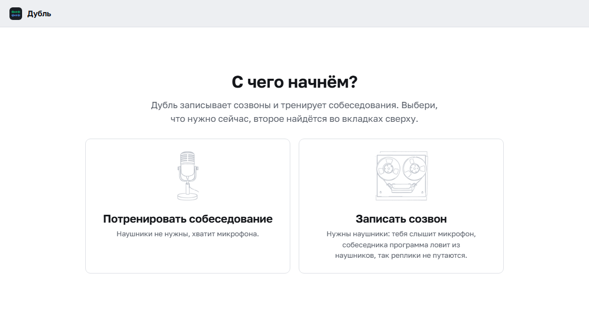
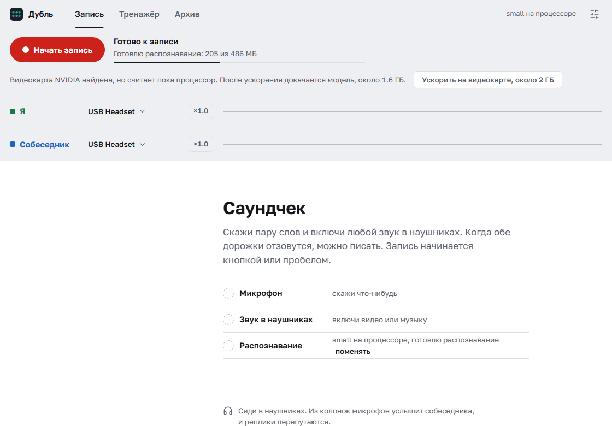
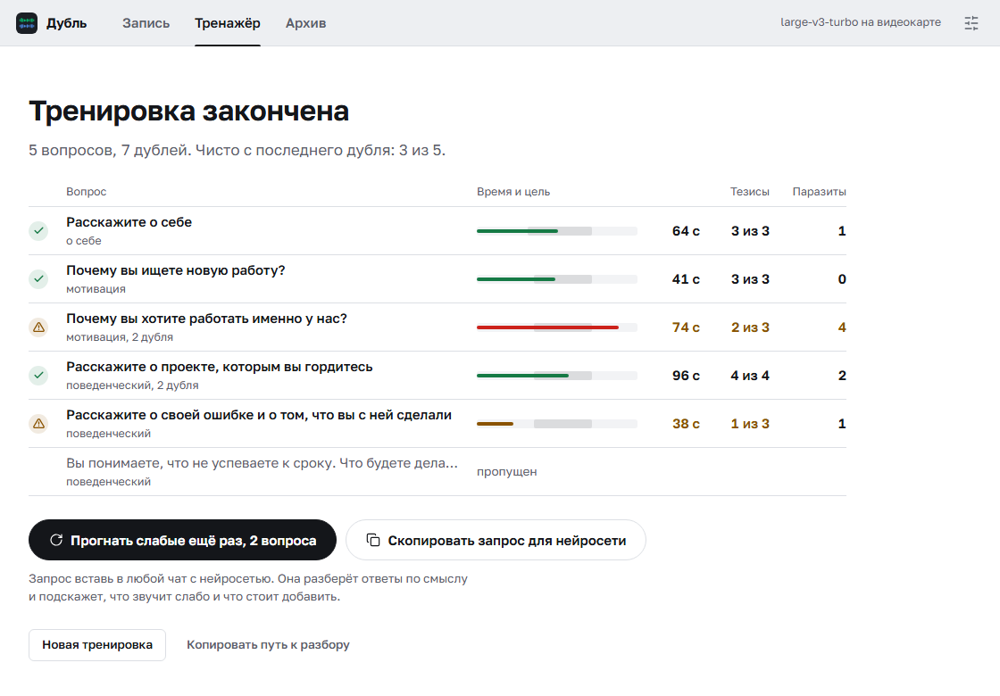
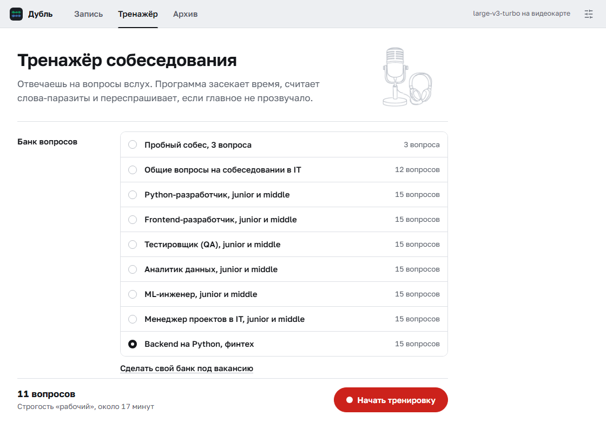

# Дубль

Живая расшифровка созвонов и тренажёр собеседований.

**[Скачать Дубль](https://github.com/ahiokk/dubl/releases/latest/download/Dubl.zip)** (Windows 10 и 11, архив ZIP).
Как поставить, написано [ниже](#установка), первый мок-собес [за пять минут](#первый-мок-собес-за-пять-минут).

Программа слушает микрофон и звук из наушников, показывает разговор текстом
по ходу дела и сразу дописывает его в markdown-файл. Путь к файлу можно отдать
ИИ-агенту посреди созвона, и он прочитает то, что сказали пару секунд назад.

Вторая половина программы это тренажёр собеседований. Ты отвечаешь вслух на вопросы
из банка. Программа засекает время, считает слова-паразиты и проверяет, прозвучали
ли главные мысли. Если что-то упустил, она переспросит, как живой интервьюер.
В комплекте восемь готовых банков, так что первый мок-собес можно пройти сразу
после установки, без чата с нейросетью и без ключей.

Речь распознаёт Whisper прямо на компьютере, видеокарта не обязательна. Можно
распознавать и через интернет-сервис по ключу.

<picture>
  <source media="(prefers-color-scheme: dark)" srcset="docs/record-dark.png">
  
</picture>

## Что нужно

- Windows 10 или 11, 64-разрядная.
- Около 1 ГБ на диске, а с ускорением на видеокарте NVIDIA до 4 ГБ. Интернет
  нужен на время установки, VPN не нужен.
- Для тренажёра хватит микрофона.
- Для записи созвона нужны наушники. Программа отличает тебя от собеседника по
  источнику звука: всё с микрофона это «Я», всё из наушников это «Собеседник».
  Из колонок микрофон поймает собеседника, и реплики перепутаются.
- Видеокарта NVIDIA желательна, но не обязательна. Без неё живая запись идёт на
  модели `small`, она путает термины. Можно распознавать и через интернет по ключу
  сервиса, подробности в разделе [«Где распознавать речь»](#где-распознавать-речь).

Python заранее ставить не нужно. Окну нужен [WebView2](https://developer.microsoft.com/microsoft-edge/webview2/):
в Windows 11 он уже есть, на Windows 10 его может не быть. Ещё нужен
[Visual C++ Redistributable x64](https://aka.ms/vs/17/release/vc_redist.x64.exe).
Его часто ставят вместе с другими программами, но на чистой системе его нет.

## Установка

1. Скачай [Dubl.zip](https://github.com/ahiokk/dubl/releases/latest/download/Dubl.zip).
   Перед распаковкой открой у архива «Свойства» и поставь галочку «Разблокировать»,
   тогда Windows не будет пугать синим окном.
2. Распакуй архив целиком («Извлечь всё») в постоянное место, например в `C:\Dubl`.
   Потом папку не переноси: ярлык и библиотеки помнят полный путь. В OneDrive
   её тоже не клади: записи созвонов уйдут в облако, а гигабайт библиотек и модели
   замедлит синхронизацию.
3. Запусти **`Установка.bat`** в папке программы. Если синее окно всё же
   появилось, нажми «Подробнее», потом «Выполнить в любом случае». В консоли
   пройдут шаги с [1/4] по [4/4]. Когда появится «Готово», нажми любую клавишу.
4. Запускай ярлыком **«Дубль»**, который появится на рабочем столе.

Установщик скачивает [uv](https://docs.astral.sh/uv/) нужной версии с GitHub,
сверяет контрольную сумму с той, что записана в самом `Установка.bat`, и кладёт
uv в папку `.uv` внутри программы. Через него ставится Python 3.12 в папку
`.python` и библиотеки, около 250 МБ, в папку `.venv`. Системный Python и PATH
не трогаются. Потом установщик сразу качает модель распознавания `small`, чтобы
первый запуск не ждал загрузки. Если интернет пропал, ничего страшного: модель
скачается при первом запуске.

Библиотеки для видеокарты, около 2 ГБ, установщик не ставит. Если у тебя NVIDIA,
программа сама предложит кнопку «Ускорить на видеокарте».

Через git тоже можно:

```bash
git clone https://github.com/ahiokk/dubl
```

Дальше тот же `Установка.bat`. Если uv у тебя уже стоит, можно и руками:

```bash
uv venv --python 3.12 --managed-python .venv
uv pip install -r requirements.txt
uv pip install -r requirements-gpu.txt
```

Последняя строка нужна только с видеокартой NVIDIA. Запуск тогда через `Дубль.bat`.

## Первый мок-собес за пять минут

1. При первом запуске окно спросит, с чего начать. Нажми «Потренировать
   собеседование». Пока ты не выбрал, микрофон не включается.
2. Банк «Пробный собес» на три вопроса и строгость «Рабочий» уже выбраны.
   В строке «Микрофон» нажми «Проверить», скажи пару слов и нажми «Готово».
3. Нажми «Начать тренировку».
4. Нажми красную кнопку «Записать ответ» или пробел, отвечай вслух, потом снова
   пробел. Свой текст ты не видишь специально, как на настоящем собесе.
5. В разборе видно время, слова-паразиты и прозвучавшие мысли. Если главное
   не прозвучало, программа задаст уточняющий вопрос. Дальше «Ещё дубль» (клавиша R)
   или «Следующий вопрос». После третьего вопроса откроется итог.



Если модель ещё качается, в строке «Готовлю распознавание» виден ход. Начинать
можно сразу: кнопка ответа подождёт, пока модель докачается.

## Запись встречи

Окно устроено как маленькая студия: две дорожки, сверху зелёная «Я», снизу
синяя «Собеседник». Пока запись не началась, по ним видно, слышит ли программа
вас обоих: микрофон и наушники слушаются только для индикатора, звук нигде не
сохраняется и никуда не уходит. Во время записи столбики показывают, кто говорит.

1. Проверь устройства в шапках дорожек: у «Я» твой микрофон, у «Собеседника»
   то, в чём ты его слышишь. Обычно программа угадывает сама и запоминает выбор.
2. Нажми «Начать запись» или пробел.
3. Под дорожками пойдёт стенограмма: время, кто говорит, текст. Кнопка
   «Путь к файлу» кладёт путь в буфер, чтобы отдать его агенту.

Пока идёт запись, можно уйти в архив или настройки. В верхней полосе будет
гореть красный огонёк с таймером, по нему возвращаешься обратно.

Реплика попадает в файл примерно через полторы секунды после того, как фраза
закончилась. Это замер на RTX 5060 Ti с моделью `large-v3`.

Программа пишет всё, что звучит в наушниках. Ролик или музыка с голосом на фоне
попадут в расшифровку как реплики собеседника, поэтому перед записью закрой
лишние вкладки со звуком.

Если реплика не распозналась (например, пропал интернет), она не теряется молча.
В ленте останется серая строка «не распознано», а в файле будет видна причина.
Если посреди записи выдернуть наушники, окно скажет, что источник отвалился.
Если закрыть окно во время записи, программа допишет последние реплики и закроется
сама.

В конце записи файл дополняется разделом «Как ты говорил»: темп, слова-паразиты,
неуверенные слова вроде «наверное» и «если честно». Разбирается только твоя речь.

## Где распознавать речь

Настройки открываются значком с ползунками справа вверху (или Ctrl+запятая),
нужный раздел называется «Распознавание речи».

**На этом компьютере.** Звук никуда не уходит. Замеры на RTX 5060 Ti:

| Модель | Скорость |
|---|---|
| `large-v3` | в 10 раз быстрее реального времени |
| `large-v3-turbo` | в 38 раз быстрее реального времени, почти вчетверо быстрее `large-v3`. Качество на моих тестах не отличалось |

На ноутбуке без видеокарты реплика в 5 секунд распознаётся моделью `small`
примерно за 5 секунд, `large-v3-turbo` за 13. Поэтому без видеокарты программа
берёт `small`.

**Какая модель качается.** Программа берёт ту, что уже есть на диске и подходит
к компьютеру. Если такой нет, она качает `small` (0.5 ГБ). `large-v3-turbo`
(1.6 ГБ) она берёт, когда для видеокарты NVIDIA поставлены библиотеки. Их ставит
кнопка «Ускорить на видеокарте, около 2 ГБ» на экране записи и в настройках.
После неё программа попросит перезапуск и докачает `large-v3-turbo`.

Модель можно выбрать и самому, в настройках в поле «Модель». Выбор остаётся
и после ускорения: если ты сам поставил `small`, программа её не поменяет.



Модель ложится в папку `models` внутри программы. Если у тебя задана переменная
`HF_HOME`, программа берёт и кладёт модели туда. У части провайдеров Hugging Face
отвечает через раз. Если он молчит 20 секунд, программа качает запасную копию
`small` или `large-v3-turbo` из [релиза на GitHub](https://github.com/ahiokk/dubl/releases/tag/models-v1),
сверяет её контрольную сумму и кладёт в `models\mirror`. Для `medium` и `large-v3`
запасной копии нет: если Hugging Face не отвечает, через полторы минуты окно
покажет ошибку и предложит одну из этих двух.

**Через интернет.** Подойдёт любой компьютер, нужен ключ сервиса. На сервер уходит
звук обеих сторон и подсказка из глоссария, так что разговоры под NDA лучше
распознавать у себя.

| Сервис | Что важно знать |
|---|---|
| Яндекс SpeechKit | Работает из России без VPN. Нужен API-ключ сервисного аккаунта с ролью `ai.speechkit-stt.user`. Глоссарий здесь не действует |
| Groq | Whisper на их серверах, по умолчанию `whisper-large-v3-turbo`, в поле «Модель» можно поставить `whisper-large-v3`. Из России может понадобиться VPN. Запрос короче 10 секунд оплачивается как 10, а реплики обычно короче, поэтому платишь больше, чем длится разговор |
| OpenAI | Из России работает только через VPN |
| Свой сервер | Любой сервер с OpenAI-совместимым `/v1/audio/transcriptions`, например [speaches](https://github.com/speaches-ai/speaches). Адрес пиши вместе с `/v1`, например `http://localhost:8000/v1`, а в поле «Модель» имя модели на этом сервере. Если адрес начинается с `http://` и это не твой компьютер, окно предупредит, что ключ и звук пойдут открытым текстом |

Ключ хранится в диспетчере учётных данных Windows, а не в файле настроек. Так
он не утечёт через git или переписку, но программы, запущенные под твоим
пользователем, прочитать его могут. Кнопка «Проверить связь» отправляет секунду
тихого шума и показывает, пускает ли сервер с этим ключом.

## Тренажёр собеседования

Вторая вкладка. Выбираешь банк вопросов, темы и строгость, отвечаешь вслух.
Каждая попытка называется дублем. Пока отвечаешь, на экране вопрос, таймер и
твоя дорожка, которая растёт по шкале времени. На шкале серым подсвечено окно
цели, например от 30 до 60 секунд, всё сказанное после него краснеет. Начать и
закончить ответ можно и пробелом. Если у вопроса есть подсказка, она свёрнута
строкой «Подсказка» под вопросом.


После ответа видно время, слова-паразиты и то, какие тезисы прозвучали. Если
главное не прозвучало, программа задаст уточняющий вопрос. Если в ответе на него
прозвучат нужные слова, тезис засчитается, но в разборе останется пометка, что
тебя пришлось переспросить. Реплики распознаются, пока ты говоришь, поэтому после
«Закончить ответ» обычно остаётся дорасшифровать только последнюю фразу. Если
компьютер распознаёт медленнее, чем ты говоришь (большая модель без видеокарты),
ждать придётся дольше.


Дубль считается чистым, если ты уложился в окно времени, слов-паразитов не больше
нормы и все тезисы прозвучали. Лучше всего тренажёр работает, когда гоняешь один
вопрос до чистого дубля. На разминке и рабочей строгости на вопрос даётся до трёх
попыток, на боевой одна. После каждой видно, что изменилось:

```
время лучше 95 с→38 с, слова-паразиты лучше 2→0, тезисы лучше 0/4→4/4
```

Строгость бывает трёх видов:

| | Вопросы | Окно времени | Слов-паразитов можно | Переспрашивает | Попыток |
|---|---|---|---|---|---|
| Разминка | простые | ×1.6, 30-60 с станет 48-96 с | в 2.5 раза больше | нет | до трёх |
| Рабочий | простые и средние | как в банке | как в банке | да | до трёх |
| Боевой | все | ×0.9, 30-60 с станет 27-54 с | на 30% меньше | да | одна |

В конце тренировки видны все вопросы сразу, а кнопка «Прогнать слабые ещё раз»
запускает только те, где последний дубль вышел нечистым. Разбор ложится в папку
`мок-собесы` двумя файлами: markdown для чтения и json с цифрами.



Программа меряет только то, что можно посчитать. Насколько ответ убедителен по
смыслу, она не знает. Для этого на последнем экране есть кнопка «Скопировать
запрос для нейросети»: вставляешь его в любой чат, и нейросеть разбирает ответы
по существу.

### Готовые банки

| Банк | Вопросов |
|---|---|
| Пробный собес | 3, для любой роли |
| Общие вопросы на собеседовании в IT | 12, от «расскажите о себе» до зарплаты и вопросов к компании |
| Python-разработчик | 15 |
| Frontend-разработчик | 15 |
| Тестировщик (QA) | 15 |
| Аналитик данных | 15 |
| ML-инженер | 15 |
| Менеджер проектов в IT | 15 |

Ролевые банки рассчитаны на junior и middle, в окне так и подписано. Сколько
вопросов пойдёт, зависит от строгости: из ролевого банка на рабочей выпадет 11
из 15, на разминке 5. В ролевых банках только технические темы, в «Общих
вопросах» и «Пробном собесе» только поведенческие.

### Свой банк под вакансию

1. В тренажёре нажми «Сделать свой банк под вакансию».
2. Вставь текст вакансии и нажми «Скопировать запрос».
3. Отправь запрос в любой чат с нейросетью, который у тебя открывается.
4. Её ответ вставь целиком, вместе с блоком кода, в поле «Вставь ответ нейросети»
   и нажми «Проверить и сохранить».
5. Банк сразу выбран, нажми «Начать тренировку». На «рабочем» идут простые и
   средние вопросы, все вопросы только на «боевом».

Мелкие ошибки в ответе программа поправит сама, переведёт его в YAML и положит
в папку `вопросы`. Если ответ оборвался или хотя бы один вопрос в нём не читается,
банк не сохранится. Окно покажет, что не так, а кнопка «Скопировать просьбу
исправить» даст текст, который нужно отправить той же нейросети.



Банк можно написать и руками. Это файл с расширением `.yaml` (не `.yml`) в папке `вопросы`. Открыть её можно
кнопкой «Открыть папку с банками» в том же блоке или в настройках, раздел «Файлы».
Программа следит за папкой: новый файл появится в списке через пару секунд.
Свои банки в git не попадают. Образец лежит в `вопросы/пример.yaml`:

```yaml
название: Пример банка, как это устроено

вопросы:
  - id: corr_cov
    вопрос: Чем корреляция отличается от ковариации?
    категория: статистика        # тема для фильтра в окне
    уровень: 1                   # 1 разминка, 2 рабочий, 3 боевой
    цель_сек: [30, 60]           # за сколько секунд надо уложиться
    паразитов_макс: 2            # сколько слов-паразитов можно
    заметка: Покажется под вопросом строкой «Подсказка»
    тезисы:
      - текст: ковариация зависит от единиц измерения
        слова: [единиц, масштаб, размерност, шкал]
        добить: От чего зависит величина ковариации?
```

У тезиса есть слова-маркеры. По ним программа решает, прозвучал тезис или нет.
Пиши маркеры с обрезанными окончаниями: распознавание отдаёт то «масштаб», то
«масштабе». В маркере из нескольких слов можно обрезать каждое слово:
`стандартн отклонен` найдёт и «стандартное отклонение», и «стандартного
отклонения». Тезис без слов программа не проверяет и всегда ставит ему галочку,
прозвучал ли он, оценишь сам. Поле `добить`
это уточняющий вопрос на случай, если тезис пропущен.

Проверка грубая, по вхождению слов. Перевёрнутое определение со всеми нужными
словами она засчитает, а смысл оценит только нейросеть по запросу с последнего
экрана. Зато проверка мгновенная, не занимает видеопамять и даёт число, которое
можно сравнивать между попытками.

Поведенческими считаются темы `поведенческий`, `мотивация`, `о себе` и `софт`,
остальные идут как технические. На этом построены кнопки «Поведенческие»
и «Технические».

## Архив

Третья вкладка. Все расшифровки и разборы тренировок, новые сверху. Поиск идёт
по тексту реплик: ищешь слово и находишь встречу, где оно прозвучало.

Кнопка «Выжимка» раскладывает встречу на договорённости, задачи, сроки, вопросы
и проблемы. Нейросети там нет, программа ищет маркеры вроде «договорились» или
«до пятницы» и дописывает найденное в конец файла. Пересказывать смысл она не
умеет, она только показывает места, куда стоит посмотреть.

## Глоссарий

`glossary.txt` подсказывает модели, как писать термины и имена: «RuBERT», а не
«Рубэрт». В нём общий список для собеседований в IT.

Название компании и имена собеседников пиши в `glossary.local.txt` рядом, файл
надо создать самому. По одному термину или имени на строку, строки с `#`
пропускаются. Сохранять можно Блокнотом в любой кодировке, какую он предлагает.
В git он не попадает, и `git pull` его не тронет. Если программа не смогла его
прочитать, причина видна в настройках распознавания. Правки подхватываются после
перезапуска программы.

Whisper берёт подсказку длиной около 220 токенов, это 40-60 терминов, а лишнее
отрезает с начала. Поэтому программа ставит личный файл первым и обрезает
список с конца сама, и имена доходят до модели. Общий список уже занимает
около 170 токенов. Около десятка коротких имён в запас влезет, дальше каждое
своё имя вытесняет хвост общего списка. Для сервисов в интернете подсказка
короче, 400 знаков.

Слова-паразиты, неуверенные слова и ориентиры темпа лежат в
`speech_patterns.yaml`. Своё пиши в `speech_patterns.local.yaml` в том же
формате, его тоже надо создать. Списки из него добавляются к общим после
перезапуска, в git он не попадает. Ошибка в этом файле не роняет программу, она его просто пропустит
и скажет об этом.

## Консольная версия

Если окно не нужно, в папке программы:

```bat
.venv\Scripts\python.exe listen.py
```

Флаги: `--list-devices` покажет номера устройств, `--only mic` пишет только тебя,
`--duration 600` остановится сам через десять минут, `--title "Созвон с заказчиком"`
попадёт в имя файла, `--api` распознаёт через сервис из настроек окна.

## Приватность

- Пока не нажата запись, звук слушается только для индикаторов и никуда не пишется.
- При распознавании на своём компьютере звук не уходит никуда. Сеть нужна только
  для загрузки модели и библиотек.
- При распознавании через интернет на сервер уходит звук обеих сторон. Все
  сервисы, кроме Яндекса, получают ещё и подсказку из глоссария вместе с твоим
  `glossary.local.txt`.
- Записи и разборы лежат в папках `расшифровки` и `мок-собесы` внутри программы.
- На диске C от программы остаются ярлык, ключи сервисов в диспетчере учётных
  данных и временная папка окна, которая удаляется при закрытии.

Предупреди собеседника, что пишешь разговор. В части стран записывать без согласия
всех сторон нельзя. В России участник разговора может его записать, но
распространять чужие личные сведения из записи нельзя.

## Безопасность

Окно программы это страница в pywebview, и прав у неё мало. Питон открывает ей
только нужные функции по точным именам, внешние скрипты страница не грузит,
а файл в окно не перетаскивается. После открытия окна процесс программы закрывает
типовые способы запустить другие программы, кроме установки ускорения на
видеокарте и своего перезапуска. Банки вопросов читаются без YAML-ссылок
и не больше 256 КБ.

Нашёл уязвимость? Сообщи закрыто через вкладку
[Security](https://github.com/ahiokk/dubl/security) этого репозитория, подробнее
в [SECURITY.md](SECURITY.md).

## Если что-то не так

**Окно не открылось или открылось пустым.** Смотри `ошибка.log` рядом с программой,
туда пишется любая ошибка запуска. Частая причина на Windows 10: нет WebView2 или
Visual C++ Redistributable, ссылки в разделе [«Что нужно»](#что-нужно).

**Установка остановилась на скачивании.** Запусти `Установка.bat` ещё раз. Если не
помогает, проверь интернет или прокси.

**В файле пусто, хотя разговор был.** Посмотри на дорожки во время записи.
Если синяя стоит ровной линией, выбрано не то устройство вывода.

**Тихий микрофон.** Нажми «×1.0» в шапке зелёной дорожки или открой раздел
«Громкость» в настройках. Усиление поднимает уровень от ×1 до ×8 внутри программы,
настройки Windows не меняются. Выше ×8 растёт шум, и распознавание портится
сильнее, чем помогает громкость. Перед тренировкой нажми «Проверить» в строке
«Микрофон».

**Собеседника слышно тихо, его реплики пропадают.** Слишком тихий голос детектор
речи не признаёт речью, и реплика теряется целиком. Нажми «×1.0» в шапке синей
дорожки и подними усиление, пока столбики не станут заметными. Звук из компьютера
чистый, без шума комнаты, поэтому его можно тянуть до ×12. Если столбики упираются
в потолок дорожки, убавь: перегруз распознаётся хуже тишины. Менять можно прямо во
время записи.

**В расшифровке фразы, которых никто не говорил.** «Субтитры сделал…»,
«Продолжение следует». Whisper выдумывает их на шуме, известные варианты
отсеиваются в `asr.py`. Если пролезла новая общая фраза, допиши её в
`HALLUCINATION_MARKERS`: она вырезается, только когда занимает почти всю реплику.
В `HALLUCINATION_SIGNATURES` идут только подписи с именами вроде «Субтитры
сделал…», они вырезаются из реплики любой длины. Файл сохраняй в UTF-8.

**Программа пишет «Восстанавливаю приложение».** Подожди, окно закроется само.
На старте программа сверяет по контрольным суммам ключевые пакеты окна и проверяет,
что всё загружается, остальные пакеты проверяет в фоне. Побитые она переставляет
с PyPI, починка найденного в фоне идёт при следующем запуске. Без интернета
починка откладывается, а если без неё программа не стартует, окно попросит
подключиться к сети.

## Как устроено

| Файл | Что делает |
|---|---|
| `Установка.bat` | uv в `.uv`, Python в `.python`, библиотеки, модель, ярлык на рабочем столе |
| `Дубль.bat` | запуск окна без ярлыка |
| `requirements.txt`, `requirements-gpu.txt` | точные версии библиотек, второй файл для видеокарты |
| `prepare_model.py` | загрузка модели из установщика |
| `run.py` | запуск: проверка целостности, починка, старт окна |
| `bootstrap.py` | папка моделей, библиотеки CUDA, проверка и починка пакетов |
| `app.py` | окно, потоки, запись файла на лету |
| `capture.py` | захват звука через WASAPI, приведение к 16 кГц, нарезка на реплики |
| `asr.py` | распознавание: Whisper на своём компьютере или сервер по API, загрузка модели |
| `api_keys.py` | ключи в диспетчере учётных данных Windows |
| `interview.py` | тренажёр: банки, проверка тезисов, уровни строгости, банк из ответа нейросети |
| `speech_metrics.py` | разбор речи: слова-паразиты, темп, паузы |
| `archive.py` | архив, поиск, выжимка |
| `listen.py` | консольная версия |
| `web/` | интерфейс на HTML, CSS и JavaScript в окне pywebview |
| `DESIGN.md`, `check_contrast.py` | правила оформления окна и проверка контраста цветов |

Несколько решений, которые выглядят странно:

- Реплики режет Silero VAD, а не порог громкости. В наушниках почти всегда есть
  фон, и порог по энергии в нём тонет.
- Устройства открываются по имени, а не по номеру. Номера в Windows плавают:
  Steam поднимает свой виртуальный вход, и весь список сдвигается.
- PortAudio запускается и открывает устройства только из одного потока, а звук
  читают уже потоки источников. Два параллельных `PyAudio()` роняют процесс
  без traceback.
- Время реплик считается по часам, а не по числу обработанных кусков звука.
  Иначе дорожки микрофона и наушников разъезжаются на длину пауз.

## Похожие проекты

- [Meetily](https://github.com/Zackriya-Solutions/meetily). Красивый и
  популярный, но тренажёра там нет, а разделение спикеров уехало в платную версию.
- [Hearsay](https://github.com/parkscloud/Hearsay). Та же идея с микрофоном и
  системным звуком, умеет подавлять эхо.
- [WhisperLive](https://github.com/collabora/WhisperLive). Библиотека для
  потокового Whisper, окна и тренажёра нет.

Здесь спикеры делятся по источнику звука. В наушниках двое не путаются: микрофон
всегда «Я», звук из компьютера всегда «Собеседник». Если на созвоне несколько
человек, все они идут как «Собеседник». Файл пишется на лету и читается агентом
прямо во время разговора. Тренажёра с уточняющими вопросами в этих проектах нет.

## Лицензия

Код и банки вопросов распространяются под [MIT](LICENSE).

Иконка и рисунки в `web/img` сделаны генератором Qwen-Image-2.1, у него лицензия
только для некоммерческого использования. MIT на них не распространяется,
подробности в [web/img/LICENSE.txt](web/img/LICENSE.txt). У шрифта Golos Text
лицензия [OFL](web/fonts/OFL-Golos.txt). Модели Whisper в запасной копии
распространяются под MIT, как и на Hugging Face.
