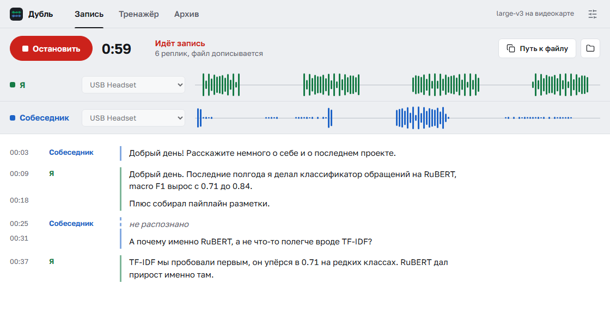
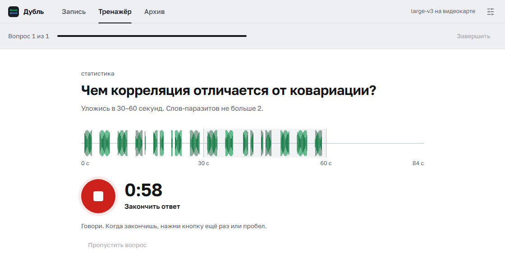
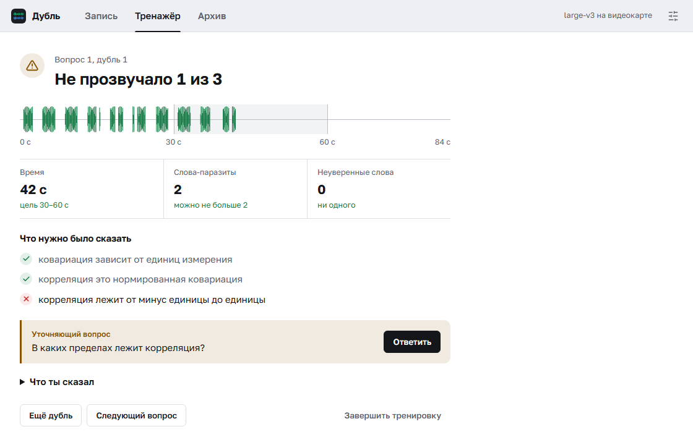

# Дубль

Живая расшифровка созвонов и тренажёр собеседований.

Программа для Windows. Слушает микрофон и звук из наушников, показывает разговор
текстом по ходу дела и сразу дописывает его в markdown-файл. Путь к файлу можно
отдать ИИ-агенту посреди созвона, и он прочитает то, что сказали пару секунд назад.

Вторая половина программы это тренажёр собеседований. Ты отвечаешь вслух на вопросы
из банка. Программа засекает время, считает слова-паразиты и проверяет, прозвучали
ли главные мысли. Если что-то упустил, она переспросит, как живой интервьюер.

Распознавать речь можно на своём компьютере через Whisper или через интернет,
если видеокарты нет.

<picture>
  <source media="(prefers-color-scheme: dark)" srcset="docs/record-dark.png">
  
</picture>

## Что нужно

- Windows 10 или 11.
- Наушники. Программа отличает тебя от собеседника по источнику звука: всё
  с микрофона это «Я», всё из наушников это «Собеседник». Из колонок микрофон
  поймает собеседника, и реплики перепутаются.
- Для распознавания на своём компьютере желательна видеокарта NVIDIA. Без неё
  живая запись идёт на модели `small`, она путает термины. Можно распознавать
  и через интернет по ключу сервиса, тогда подойдёт любой компьютер, подробности
  в разделе [«Где распознавать речь»](#где-распознавать-речь).

Python заранее ставить не нужно.

## Установка

1. Скачай программу. На этой странице зелёная кнопка **Code**, в ней пункт
   **Download ZIP**, потом распакуй архив. Или через git:
   ```bash
   git clone https://github.com/ahiokk/dubl
   ```
2. Запусти **`Установка.bat`** в папке программы. Если программа скачана
   архивом, Windows может предупредить, что файл из интернета. В синем окне
   нажми «Подробнее», потом «Выполнить в любом случае».
3. Запускай ярлыком **«Дубль»**, который появится на рабочем столе.

Установщик ставит [uv](https://docs.astral.sh/uv/), а через него библиотеки,
около 250 МБ. Если находит видеокарту NVIDIA, докачивает ещё 2 ГБ библиотек
CUDA. Библиотеки ложатся в папку `.venv` внутри программы. Если на компьютере
нет Python 3.12, uv скачает его туда же, в папку `.python`. Системный Python
не трогается, а на диске C остаётся только сам uv, это 65 МБ.

Модель Whisper скачается при первой записи: `large-v3` весит 3 ГБ, `small`
полгигабайта. Она тоже ляжет внутрь программы, в папку `models`.

Если uv у тебя уже стоит, можно и руками:

```bash
uv venv --python 3.12 .venv
uv pip install -r requirements.txt
uv pip install -r requirements-gpu.txt
```

Последняя строка нужна только с видеокартой NVIDIA. Запуск тогда через `Дубль.bat`.

## Запись встречи

Окно устроено как маленькая студия: две дорожки, сверху зелёная «Я», снизу
синяя «Собеседник». Во время записи по ним бегут столбики громкости, и с одного
взгляда видно, кто сейчас говорит и слышит ли программа вас обоих.

1. Проверь устройства в шапках дорожек: у «Я» твой микрофон, у «Собеседника»
   то, в чём ты его слышишь. Обычно программа угадывает сама.
2. Нажми «Начать запись».
3. Под дорожками пойдёт стенограмма: время, кто говорит, текст. Кнопка
   «Путь к файлу» кладёт путь в буфер, чтобы отдать его агенту.

Пока идёт запись, можно уйти в архив или настройки. В верхней полосе будет
гореть красный огонёк с таймером, по нему возвращаешься обратно.

Реплика попадает в файл примерно через полторы секунды после того, как фраза
закончилась. Это замер на RTX 5060 Ti с моделью `large-v3`.

Программа пишет всё, что звучит в наушниках. Ролик или музыка с голосом на фоне
попадут в расшифровку как реплики собеседника, поэтому перед записью закрой
лишние вкладки со звуком.

Если реплика не распозналась (например, пропал интернет), она не теряется молча.
В ленте останется серая строка «не распознано», а в файле будет видна причина.

В конце записи файл дополняется разделом «Как ты говорил»: темп, слова-паразиты,
неуверенные слова вроде «наверное» и «если честно». Разбирается только твоя речь.

## Где распознавать речь

Выбирается во вкладке «Настройки».

**На этом компьютере.** Звук никуда не уходит. Замеры на RTX 5060 Ti:

| Модель | Скорость |
|---|---|
| `large-v3` | в 10 раз быстрее реального времени |
| `large-v3-turbo` | в 38 раз быстрее, качество на моих тестах не отличалось |

На ноутбуке без видеокарты реплика в 5 секунд распознаётся моделью `small`
примерно за 5 секунд, `large-v3-turbo` за 13. Поэтому без видеокарты программа
сама предлагает `small`.

**Через интернет.** Подойдёт любой компьютер, нужен ключ сервиса. Звук каждой
реплики уходит на сервер, так что разговоры под NDA лучше распознавать у себя.

| Сервис | Что важно знать |
|---|---|
| Яндекс SpeechKit | Работает из России без VPN. Нужен API-ключ сервисного аккаунта с ролью `ai.speechkit-stt.user`. Глоссарий здесь не действует |
| Groq | Whisper large-v3 на их серверах. Запрос короче 10 секунд оплачивается как 10, а реплики обычно короче, поэтому платишь больше, чем длится разговор |
| OpenAI | Из России работает только через VPN |
| Свой сервер | Любой сервер с OpenAI-совместимым `/v1/audio/transcriptions`, например [speaches](https://github.com/speaches-ai/speaches) |

Ключ хранится в диспетчере учётных данных Windows, а не в файле настроек.
Кнопка «Проверить связь» отправляет секунду тихого шума и показывает, пускает ли
сервер с этим ключом.

## Тренажёр собеседования

Вторая вкладка. Выбираешь банк вопросов, темы и строгость, отвечаешь вслух.
Каждая попытка называется дублем. Пока отвечаешь, на экране вопрос, таймер и
твоя дорожка, которая растёт по шкале времени. На шкале серым подсвечено окно
цели, например от 30 до 60 секунд, всё сказанное после него краснеет. Начать и
закончить ответ можно и пробелом. Свой текст ты не видишь специально: увидев
его, начинаешь читать себя, и речь рвётся.



В комплекте лежит банк «Общие вопросы на собеседовании в IT». Там двенадцать
вопросов, которые звучат почти на любом собеседовании, от «расскажите о себе»
до зарплаты и вопросов к компании. Технических вопросов в нём нет, они зависят
от роли. Такой банк под твою вакансию соберёт любая нейросеть, запрос есть
в разделе [«Свой банк вопросов»](#свой-банк-вопросов).

В разборе остаётся та же дорожка, и по ней видно, где были паузы.

После ответа видно время, слова-паразиты и то, какие тезисы прозвучали. Если
главное не прозвучало, программа задаст уточняющий вопрос. Ответишь на него, и
тезис засчитается, но в разборе останется пометка, что тебя пришлось переспросить.



Лучше всего тренажёр работает, когда гоняешь один вопрос до чистого ответа.
После каждой попытки видно, что изменилось:

```
время лучше 95 с→38 с, слова-паразиты лучше 2→0, тезисы лучше 0/4→4/4
```

Строгость бывает трёх видов:

| | Вопросы | Время | Вторая попытка |
|---|---|---|---|
| разминка | простые | в 1.6 раза мягче | есть |
| рабочий | простые и средние | как в банке | есть |
| боевой | все | на 10% строже | нет |

В конце тренировки разбор ложится в папку `мок-собесы` двумя файлами: markdown
для чтения и json с цифрами. Программа меряет только то, что можно посчитать.
Насколько ответ убедителен по смыслу, она не знает. Для этого на последнем экране
есть кнопка «Скопировать запрос для нейросети»: вставляешь его в любой чат, и
нейросеть разбирает ответы по существу.

### Свой банк вопросов

Банк это YAML-файл в папке `вопросы`. Программа следит за папкой: новый файл
появится в списке через пару секунд, перезапускать окно не нужно. Свои банки
в git не попадают. Общий банк перед правкой скопируй в свой файл, поменяй в нём
`название` и допиши компанию, например её продукты в слова тезисов вопроса
«почему мы». Образец лежит в `вопросы/пример.yaml`:

```yaml
название: Пример банка, как это устроено

вопросы:
  - id: corr_cov
    вопрос: Чем корреляция отличается от ковариации?
    категория: статистика        # тема для фильтра в окне
    уровень: 1                   # 1 разминка, 2 рабочий, 3 боевой
    цель_сек: [30, 60]           # за сколько секунд надо уложиться
    паразитов_макс: 2            # сколько слов-паразитов можно
    тезисы:
      - текст: ковариация зависит от единиц измерения
        слова: [единиц, масштаб, размерност, шкал]
        добить: От чего зависит величина ковариации?
```

У каждого тезиса есть слова-маркеры. По ним программа решает, прозвучал тезис
или нет. Пиши маркеры с обрезанными окончаниями: распознавание отдаёт то
«масштаб», то «масштабе». Поле `добить` это уточняющий вопрос на случай, если
тезис пропущен.

Проверка грубая, по вхождению слов. Зато она мгновенная, не занимает видеопамять
и даёт число, которое можно сравнивать между попытками.

Банк проще всего попросить у нейросети. Подойдёт такой запрос, в конец добавь
текст вакансии:

```text
Сделай банк вопросов для тренировки собеседования в формате YAML.
Ключи строго такие: название, вопросы. У каждого вопроса: id, вопрос,
категория, уровень (1, 2 или 3), цель_сек ([от, до] в секундах),
паразитов_макс, тезисы. У каждого тезиса: текст, слова, добить.
слова это 3-5 корней слов, по которым видно, что тезис прозвучал,
с обрезанными окончаниями. добить это уточняющий вопрос, если тезис
не прозвучал. Поведенческие вопросы помечай категорией «поведенческий».
Сделай 15 вопросов под эту вакансию:
```

Поведенческими считаются темы `поведенческий`, `мотивация`, `о себе` и `софт`,
остальные идут как технические. На этом построены кнопки «Только поведенческие»
и «Только технические».

## Архив

Третья вкладка. Все расшифровки и разборы тренировок, новые сверху. Поиск идёт
по тексту внутри файлов: ищешь слово и находишь встречу, где оно прозвучало.

Кнопка «Выжимка» раскладывает встречу на договорённости, задачи, сроки, вопросы
и проблемы. Нейросети там нет, программа ищет маркеры вроде «договорились» или
«до пятницы» и дописывает найденное в конец файла. Пересказывать смысл она не
умеет, она только показывает места, куда стоит посмотреть.

## Глоссарий

`glossary.txt` подсказывает модели, как писать термины и имена: «RuBERT», а не
«Рубэрт». В нём общий список для собеседований в IT.

Название компании и имена собеседников пиши в `glossary.local.txt` рядом, файл
надо создать самому. В git он не попадает, и `git pull` его не тронет.

Whisper берёт подсказку длиной около 220 токенов, это 40-60 терминов, а лишнее
отрезает с начала. Поэтому программа ставит личный файл первым и обрезает
список с конца сама, и имена доходят до модели. Общий список уже занимает
около 170 токенов, так что каждое своё имя вытесняет хвост общего.

Слова-паразиты, неуверенные слова и ориентиры темпа лежат в
`speech_patterns.yaml`. Своё пиши в `speech_patterns.local.yaml` в том же
формате, его тоже надо создать. Списки из него добавляются к общим, в git он
не попадает.

## Консольная версия

Если окно не нужно:

```bash
.venv\Scripts\python.exe listen.py
```

Флаги: `--list-devices` покажет номера устройств, `--only mic` пишет только тебя,
`--duration 600` остановится сам через десять минут, `--title "Созвон с заказчиком"`
попадёт в имя файла, `--api` распознаёт через сервис из настроек окна.

## Если что-то не так

**В файле пусто, хотя разговор был.** Посмотри на дорожки во время записи.
Если синяя стоит ровной линией, выбрано не то устройство вывода.

**Тихий микрофон.** Ползунок «Усиление» в настройках поднимает уровень от ×1
до ×8 внутри программы, настройки Windows не меняются. Выше ×8 растёт шум, и распознавание
портится сильнее, чем помогает громкость. Перед тренировкой нажми «Проверить»
в строке «Микрофон».

**В расшифровке фразы, которых никто не говорил.** «Субтитры сделал…»,
«Продолжение следует». Whisper выдумывает их на шуме, известные варианты
отсеиваются в `asr.py`. Если пролезло новое, допиши кусок фразы
в `HALLUCINATION_MARKERS`.

**Окно не открылось.** Смотри `ошибка.log` рядом с программой.

**Программа пишет «Восстанавливаю приложение».** Подожди. При запуске она
сверяет файлы установленных пакетов с их контрольными суммами и переставляет
побитые. Так она лечится после антивируса или сбойного диска.

## Как устроено

| Файл | Что делает |
|---|---|
| `Установка.bat` | uv, Python, библиотеки, ярлык на рабочем столе |
| `run.py` | запуск: проверка целостности, починка, старт окна |
| `app.py` | окно, потоки, запись файла на лету |
| `capture.py` | захват звука через WASAPI, приведение к 16 кГц, нарезка на реплики |
| `asr.py` | распознавание: Whisper на своём компьютере или сервер по API |
| `api_keys.py` | ключи в диспетчере учётных данных Windows |
| `interview.py` | тренажёр: банк, проверка тезисов, уровни строгости |
| `speech_metrics.py` | разбор речи: слова-паразиты, темп, паузы |
| `archive.py` | архив, поиск, выжимка |
| `web/` | интерфейс на HTML, CSS и JavaScript в окне pywebview |

Несколько решений, которые выглядят странно:

- Реплики режет Silero VAD, а не порог громкости. В наушниках почти всегда есть
  фон, и порог по энергии в нём тонет.
- Устройства открываются по имени, а не по номеру. Номера в Windows плавают:
  Steam поднимает свой виртуальный вход, и весь список сдвигается.
- PortAudio трогается только из одного потока. Два параллельных `PyAudio()`
  роняют процесс без traceback.
- Время реплик считается по часам, а не по числу обработанных кусков звука.
  Иначе дорожки микрофона и наушников разъезжаются на длину пауз.

## Похожие проекты

- [Meetily](https://github.com/Zackriya-Solutions/meetily). Красивый и
  популярный, но тренажёра там нет, а разделение спикеров уехало в платную версию.
- [Hearsay](https://github.com/parkscloud/Hearsay). Та же идея с микрофоном и
  системным звуком, умеет подавлять эхо.
- [WhisperLive](https://github.com/collabora/WhisperLive). Библиотека для
  потокового Whisper, окна и тренажёра нет.

Здесь спикеры делятся по источнику звука, поэтому на двоих не путаются никогда,
а файл пишется на лету и читается агентом прямо во время разговора. Тренажёра
с уточняющими вопросами в этих проектах нет.

## Лицензия

Код распространяется под [MIT](LICENSE).

Иконка и рисунки в `web/img` сделаны генератором Qwen-Image-2.1, у него лицензия
только для некоммерческого использования. MIT на них не распространяется,
подробности в [web/img/LICENSE.txt](web/img/LICENSE.txt). У шрифта Golos Text
лицензия [OFL](web/fonts/OFL-Golos.txt).
